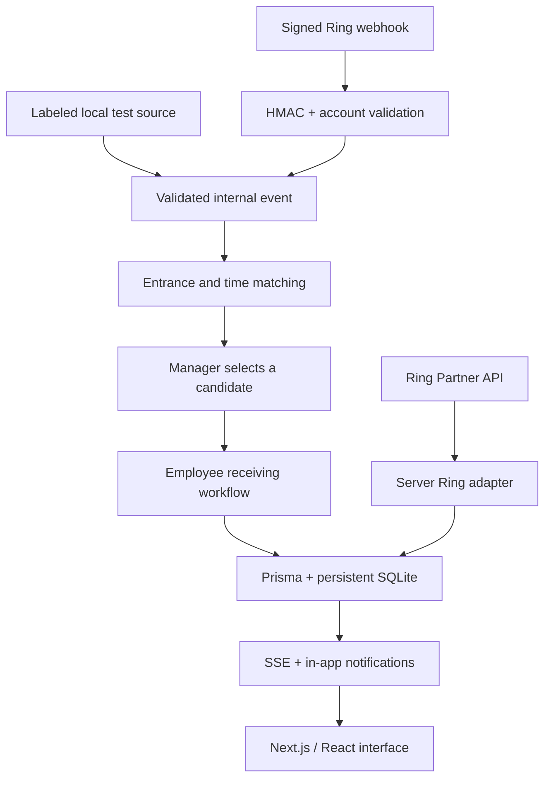

# DeliveryPilot

**Turn your Ring camera into a delivery operations assistant.**

DeliveryPilot connects entrance activity with a real receiving workflow: schedule a delivery → correlate an arrival candidate → select a possible match → assign an employee → acknowledge → receive → confirm. It persists the entire handoff and audit trail in SQLite.

## Latest-source webhook verification

This update starts from the supplied **latest working archive**, preserving its working ICE fallback, query-bearing WHEP session URL handling, and Ring authentication. The owner reports successful real Playground package playback and device discovery with this version. Those protected files were not changed during webhook verification.

To repeat the signed-webhook verification on Windows after building:

```powershell
npm.cmd run build
npm.cmd run webhook:verify
```

The runner starts a temporary loopback-only production instance, applies the existing migration to an isolated temporary SQLite database, signs generated events with an ephemeral local key, and verifies the full callback → matching → manager selection → Alex assignment/notification → receipt/audit chain. It stops its own server and removes its temporary database. It does not read or modify your normal database or Ring credentials. No browser or real Ring account is required for this test.

**108 automated tests and 20 real-HTTP checks passed.** Generated callbacks are labeled `SIMULATED_RING_WEBHOOK` / **Simulated webhook**. Partner callbacks retain `RING_WEBHOOK`. Matching remains automatic; the existing manager-selection step before task assignment is preserved.

See [the focused verification report and complete changed-file list](docs/WEBHOOK_VERIFICATION.md) and [executed HTTP results](docs/webhook-http-results.json). Keep your existing `.env.local`, `.env`, database, and installed dependencies when applying these source changes. No schema migration is introduced.

## Run locally (Windows, macOS, Linux)

Install Node.js **22.12+** (Node 24 was used for validation).

```bash
npm ci
```

Copy `.env.example` to `.env` (PowerShell: `Copy-Item .env.example .env`; macOS/Linux: `cp .env.example .env`). Then:

```bash
npm run setup
npm run dev
```

Open **http://localhost:3000**. `setup` generates Prisma Client, applies the checked-in migration, and seeds repeatable demo records. It does not reset existing data. The default business timezone is Asia/Tashkent; change it in Settings. The three seed delivery windows are on the business calendar date when the database is first initialized. For a demo on a later day, edit their windows in Deliveries before creating tasks. The seed never invents receipts or completed timestamps.

Production build locally:

```bash
npm run build
npm start
```

`npm start` binds to localhost by default. This repository has not been publicly deployed or submitted.

## What works without Ring credentials

All seven sections: Overview, Deliveries, Ring Live, Receiving Tasks, Employees, Activity History, Settings. Delivery and employee create/edit, schedule search/filter, location and camera mapping, notifications, availability, reassignment, issue reporting/escalation/resolution, persistent task transitions, source-labeled history, business timezone conversion, light/dark mode, and Server-Sent Events updates.

Local test mode is explicit. The Ring video player never displays substitute footage. Package/Vehicle/Motion are available only if returned by real Playground device discovery.

## Connect the real Ring Playground

1. Sign in to https://developer.amazon.com/ring/console/playground and generate an access token.
2. Set `RING_ACCESS_TOKEN="..."` in **`.env.local`**, on the server. Leave refresh-token fields empty. Do not put secrets in chat, source control, or any `NEXT_PUBLIC_` variable.
3. Restart Next.js. In **Settings**, press **Verify & discover devices**. A successful real response is saved with its timestamp and HTTP status. Device status and video capability are queried from Ring; an unknown status stays unknown.
4. Map each discovered camera to an entrance in Settings. Open Ring Live, choose the sample/device, and press **Start live view**. Package, Vehicle, and Motion samples are discovered as provided by the account; no API fields or sample IDs are fabricated.
5. `npm run ring:verify` performs and records a live `GET /v1/devices` check, emitting safe proof metadata without credentials.

**Latest working status:** the owner has verified real Ring API authentication, device discovery, mapping, and Playground package video in the supplied latest source. This webhook-only update preserves that code byte for byte. This environment verified signed simulated callbacks; it did not rerun real video playback or receive an authentic Ring-origin notification.

Playground tokens are short-lived (the official starter describes approximately 30 minutes). A 401 is surfaced as an expired/rejected token; regenerate it and restart. Production partner refresh mode uses `RING_REFRESH_TOKEN`, `RING_CLIENT_ID`, and `RING_CLIENT_SECRET` with the documented OAuth token endpoint and a server-memory cache.

See [Ring integration details](docs/RING_INTEGRATION.md).

## Two-minute local workflow

1. Start as **Morgan Lee** (manager). Inspect the three expected deliveries.
2. Overview → **Create test activity** → Expected arrival → Entrance A → default 14:20 → Generate. Its source is **Local test**.
3. Ring Live → open the activity → inspect the location/time explanations → select **Northline Supplies**. A receiving task is assigned to Alex; the delivery is still unconfirmed.
4. Use **Acting as** to select **Alex**. Open the notification bell and Receiving Tasks.
5. Acknowledge → Start receiving → Confirm received. The actual acting employee and wall-clock timestamps are audited.
6. Overview recalculates metrics. Deliveries → Northline → inspect the full trail. Return to Morgan for management actions.

Alternative local scenarios are in the test-event dialog: unmatched activity, ambiguous matches (adds a schedule fixture), late delivery (adds an overdue fixture), employee unavailable (marks Alex unavailable; restore in Employees), and duplicate request (uses a fixed ID; repeat it). These create persistent demo records and never claim to be authentic Ring webhooks.

## Data and evidence semantics

| Source                   | What it means                                                                            |
| ------------------------ | ---------------------------------------------------------------------------------------- |
| `DEMO_SEED`              | Repeatable example schedule; no arrival evidence                                         |
| `LOCAL_TEST`             | Manually generated test event, clearly labeled                                           |
| `RING_API`               | Real upstream API discovery or WHEP-session result                                       |
| `RING_WEBHOOK`           | Raw-body HMAC verified, account-checked Ring notification                                |
| `SIMULATED_RING_WEBHOOK` | Correctly signed generated callback in explicit demo simulation mode; not real Ring data |
| `HUMAN`                  | Action by the current workspace employee/session                                         |

A match is a **deterministic rule score**, never a probability or recognition confidence. Same entrance and inside the expected window scores 100. Early activity up to 30 minutes and late activity up to 120 minutes score lower. Outside those bounds, another entrance, unmapped devices, archived or ineligible deliveries do not match. Ambiguity requires a manager selection. One event can create one task; one delivery has one task. Duplicate source/request IDs do not repeat actions.

Audit timestamps always represent actual writes. A local scenario's reported occurrence time may be simulated; it is shown separately. Acknowledgment time is assignment → acknowledgment. Receiving time is start (or acknowledgment when no separate start) → employee confirmation. Today metrics use the configured business calendar; timing means use tasks assigned today. Dashboard totals may contain both real and labeled test records in demo mode.

## Architecture



| Module                       | Responsibility                                                                                |
| ---------------------------- | --------------------------------------------------------------------------------------------- |
| `lib/ring/`                  | Server-only token handling, real discovery/history/WHEP, raw HMAC, source-preserving adapters |
| `lib/matching.ts`            | Pure deterministic ranking                                                                    |
| `lib/workflow.ts`            | Transactional deliveries, candidates, tasks, role checks, audit and notifications             |
| `lib/state.ts`               | Persistent read model and computed metrics                                                    |
| `app/api/[...path]/route.ts` | Validated HTTP API and database-backed SSE                                                    |
| `prisma/`                    | Relational schema, initial migration, idempotent seed                                         |
| `components/`                | Responsive React interface and Radix/shadcn-style components                                  |
| `tests/`                     | Vitest integration/unit tests and Playwright end-to-end suite                                 |

SSE polls the shared audit revision every second, so it works across multiple Node processes against the same SQLite file. It does not rely on an in-memory notification list. All business mutations write an actor-attributed audit entry in the same transaction. Notification read markers and technical connection/session records are persisted separately. Camera video is neither stored nor analyzed.

## Validation

```bash
npm run typecheck
npm run lint
npm test
npm run build
# First-time local browser setup:
npx playwright install chromium
npm run test:e2e
```

Vitest uses **`prisma/test.db`**, isolated from application data. Playwright uses its own database/server unless `E2E_BASE_URL` points at an already running local preview; that option exercises the preview's demo database. See `docs/VALIDATION.md` for executed results and limitations.

## Session / operational scope

This is a single-business local hackathon application. Demo mode deliberately allows switching the acting employee. It is not an authenticated proof of a real person's identity. Every demo action still records the selected actor. Do not expose this mode to an untrusted network.

With `DEMO_MODE=false`, local test events and employee impersonation are disabled. Set a random `APP_SESSION_SECRET` (32+ characters) and `APP_ADMIN_PASSWORD` (12+ characters). A password-gated manager session is issued in a signed HttpOnly, SameSite cookie. Manager-only operations and receiver task ownership are enforced server-side. A real multi-user deployment needs organizational identity/SSO and trusted HTTPS hosting before inviting staff. The code does not pretend to implement Ring account-link onboarding; partner refresh credentials must come from a properly registered and linked integration.

Webhook endpoint: `POST /api/webhooks/ring`. Enable with the actual partner HMAC key and linked `RING_ACCOUNT_ID`. It requires registered HTTPS reachability; no public endpoint has been created here. Ring signatures are verified against raw bytes before JSON parsing and events are deduplicated by `(source, request_id)`. Non-activity lifecycle events are logged but do not create delivery matches. Raw event JSON remains server-side; the UI receives summaries and provenance only.

SQLite is suitable for this local demo and a small single-instance workspace. Add an identity provider, rate limiting at the reverse proxy, retention controls, and an operational queue if turning this into a public multi-business service. UI history displays the latest 1,000 audit records and 100 events; the database retains older records.

## Submission materials

- [Devpost draft](docs/DEVPOST_DRAFT.md)
- [2:50 demonstration script](docs/DEMO_SCRIPT.md)
- [Current submission checklist](docs/SUBMISSION_CHECKLIST.md)
- [Product feedback](docs/PRODUCT_FEEDBACK.md)
- [Developer friction log](docs/FRICTION_LOG.md)
- [Third-party notices](THIRD_PARTY_NOTICES.md)

These are drafts; nothing has been sent, published, or submitted. Record the real Ring connection before submitting a Ring-track demo. No AWS mini-challenge claim is made.
